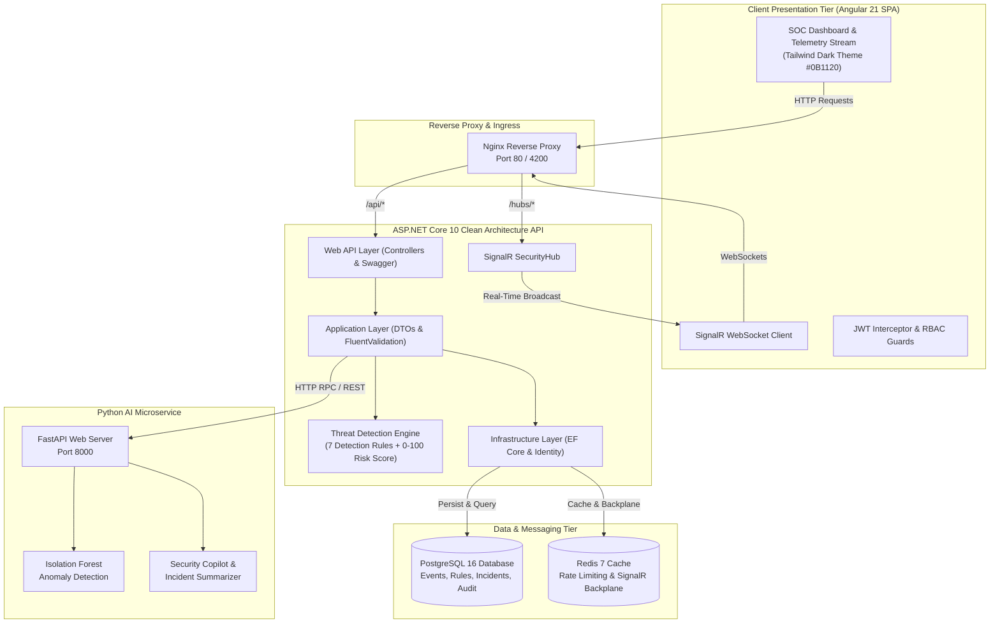

# SecureWatch – Enterprise AI-Powered Security Monitoring & Threat Detection Platform (SIEM)

[](https://github.com/securewatch/securewatch/actions)
[](https://dotnet.microsoft.com/)
[](https://angular.dev/)
[](https://fastapi.tiangolo.com/)
[](https://www.postgresql.org/)
[](https://redis.io/)
[](https://learn.microsoft.com/aspnet/core/signalr/)
[](LICENSE)

> **SecureWatch** is a production-grade, Security Information and Event Management (SIEM)-inspired cybersecurity telemetry and automated incident response platform. Built with **ASP.NET Core 10 Clean Architecture**, an **Angular 21 reactive SPA**, and an independent **Python 3.14 AI microservice**, SecureWatch ingests high-volume security telemetry, detects threat patterns using an explainable 0–100 risk scoring engine, correlates suspicious behavior into triage-ready incidents, and provides real-time security alerts via SignalR.

---

## Table of Contents

- [Key Highlights & Architectural Pillars](#key-highlights--architectural-pillars)
- [System Architecture](#system-architecture)
- [Interactive Attack Simulator](#interactive-attack-simulator)
- [Explainable Threat Detection & Risk Scoring](#explainable-threat-detection--risk-scoring)
- [AI Copilot & Anomaly Detection](#ai-copilot--anomaly-detection)
- [Role-Based Access Control (RBAC) & Demo Credentials](#role-based-access-control-rbac--demo-credentials)
- [System Requirements](#system-requirements)
- [Quick Start: Docker Compose](#quick-start-docker-compose)
- [Local Development Setup (Bare Metal)](#local-development-setup-bare-metal)
- [API Reference & Swagger Documentation](#api-reference--swagger-documentation)
- [Test Strategy & Verification](#test-strategy--verification)
- [Project Directory Layout](#project-directory-layout)
- [Security Hardening & Production Compliance](#security-hardening--production-compliance)

---

## Key Highlights & Architectural Pillars

- **Real-Time Telemetry Streaming:** Ingests high-frequency security events and streams live telemetry to SOC analysts via ASP.NET Core SignalR WebSockets with sub-second latency.
- **Explainable Rule-Based Risk Engine:** Automatically classifies events, computes dynamic 0–100 risk scores, and correlates multi-event attack vectors without "black box" decisions.
- **Incident Lifecycle Management:** Tracks security incidents from detection through investigation, notes, severity updates, and resolution with MITRE ATT&CK mapping.
- **IP Reputation Intelligence:** Evaluates IPv4/IPv6 threat history, country/region attribution, ISP/organization data, and threat indicators with resilient fallback caching.
- **Scikit-learn Isolation Forest Anomaly Detection:** Python FastAPI microservice trains unsupervised anomaly detection models to detect deviations in login cadence and geographic velocity.
- **Cyber Attack Simulator:** In-app attack orchestrator that generates realistic attack patterns (brute force credential stuffing, distributed scans, privilege escalations) to test detection rules in real time.
- **Enterprise Dark Theme SOC UI:** Engineered with Angular 21 Signals, responsive cyber defense palette (`#0B1120`, `#111827`, `#38BDF8`), Lucide iconography, and real-time dashboards.

---

## System Architecture



### Clean Architecture Breakdown

| Layer | Responsibility | Key Components |
|---|---|---|
| **SecureWatch.Domain** | Core domain entities, enterprise business rules, enums, value objects. Zero external dependencies. | `SecurityEvent`, `SecurityRule`, `ThreatDetection`, `Incident`, `IPReputation`, `Alert`, `AuditLog`. |
| **SecureWatch.Application** | CQRS-inspired service contracts, DTOs, FluentValidation rules, business interfaces. | `ISecurityDbContext`, `IThreatDetectionEngine`, `IAuthService`, `IIncidentService`, `IDashboardService`. |
| **SecureWatch.Infrastructure** | External concerns, persistence, ASP.NET Core Identity, JWT generation, EF Core DbContext, SignalR Hub. | `SecureWatchDbContext`, `ThreatDetectionEngine`, `SecurityHub`, `DatabaseSeeder`, `EventSimulatorService`. |
| **SecureWatch.Api** | REST Controllers, middleware pipeline, exception handling, rate limiting, and OpenAPI specification. | `AuthController`, `EventsController`, `ThreatsController`, `IncidentsController`, `DashboardController`, `SimulatorController`. |

---

## Interactive Attack Simulator

SecureWatch includes a built-in **Cyber Attack Simulator** accessible directly from the top navigation bar or through the REST API (`POST /api/v1/simulator/execute`). It allows security teams to simulate realistic attack scenarios against the detection engine and watch alerts trigger in real time:

```
[Attack Simulator Modal]
 ├── Scenario 1: Credential Stuffing / Brute Force (25 failed logins from single IP)
 ├── Scenario 2: Compromised Account Access (Repeated failures followed by immediate success)
 ├── Scenario 3: Known Malicious IP Probing (Hostile traffic from Tor/botnet addresses)
 ├── Scenario 4: Distributed Password Spraying (Multiple user accounts probed from one IP)
 └── Scenario 5: Off-Hours Privilege Escalation (Administrative privilege change at 03:00 UTC)
```

Triggering any scenario updates the **Total Telemetry Events**, triggers the **Threat Detection Engine**, updates the **Dashboard risk widgets**, broadcasts via **SignalR**, and creates a linked **Security Incident** with full audit logs.

---

## Explainable Threat Detection & Risk Scoring

Unlike black-box SIEM implementations, SecureWatch evaluates events using deterministic, explainable security rules coupled with a mathematical risk score normalized to **0–100**:

$$\text{Risk Score} = \min\left(100, \; \text{Base Weight} \times \text{Factor Multiplier} + \sum \text{Historical Indicators}\right)$$

### Active Core Detection Rules

| Rule ID | Rule Name | Condition & Window | Default Severity | Base Risk |
|---|---|---|---|---|
| `RULE-BRUTE-01` | High-Frequency Brute Force | $\ge 5$ failed logins within 60 seconds | High | 65 |
| `RULE-BRUTE-02` | Mass Credential Stuffing | $\ge 20$ failed logins within 120 seconds | Critical | 85 |
| `RULE-AUTH-03` | Compromised Account Access | Successful login immediately following $\ge 3$ failures | High | 70 |
| `RULE-SPRAY-04` | Distributed Account Spray | Accessing $\ge 3$ distinct accounts from 1 IP | High | 75 |
| `RULE-THREAT-05` | Known Malicious IP Traffic | Activity originating from known C2/botnet IP | Critical | 90 |
| `RULE-ANOMALY-06`| Temporal Login Anomaly | Authentications between 01:00 and 04:00 UTC | Medium | 45 |
| `RULE-GEO-07` | Geographic Anomaly Probe | Multiple login events from unrecognized foreign locales | Medium | 50 |

---

## AI Copilot & Anomaly Detection

The Python 3.14 AI Microservice runs independently on port `8000`:

1. **Isolation Forest Anomaly Detection (`/detect-anomalies`):**
   - Analyzes multidimensional telemetry (failed login frequency, temporal deviation from normal business hours, IP hop rate, account probe velocity).
   - Flags multivariate outliers that traditional static thresholds miss.
2. **AI Incident Analysis & MITRE Mapping (`/analyze-incident`):**
   - Generates executive incident summaries.
   - Maps suspicious activity to MITRE ATT&CK tactics (`T1110 - Brute Force`, `T1078 - Valid Accounts`).
   - Recommends actionable SOC triage playbooks (e.g., account lockouts, IP firewall blocks, credential resets).
3. **Natural Language Security Copilot (`/chat`):**
   - Answers natural language questions from analysts (e.g., *"What were the most critical security incidents today?"*, *"Explain why IP 198.51.100.45 was flagged as high risk"*).

---

## Role-Based Access Control (RBAC) & Demo Credentials

SecureWatch enforces Role-Based Access Control at both the backend API policy level and frontend route guard level.

| Role | Telemetry & Live Stream | Incident Response | Threat Rules Config | User & System Admin |
|---|:---:|:---:|:---:|:---:|
| **Super Admin** | Full | Full | Full | Full |
| **Security Administrator** | Full | Full | Full | View Only |
| **Security Analyst** | Full | Full (Triage & Notes) | Read Only | None |
| **Auditor** | Read Only | Read Only | Read Only | None |

### Pre-Configured Demo Credentials

The database automatically seeds with four accounts for testing (with 1-click quick fill buttons on the login page):

| Role | Username / Email | Password |
|---|---|---|
| **Super Admin** | `admin@securewatch.local` | `SecureWatch@2026!` |
| **Security Administrator** | `secadmin@securewatch.local` | `SecureWatch@2026!` |
| **Security Analyst** | `analyst@securewatch.local` | `SecureWatch@2026!` |
| **Auditor** | `auditor@securewatch.local` | `SecureWatch@2026!` |

---

## System Requirements

- **Docker:** Docker Engine 24.0+ and Docker Compose v2.20+
- **Bare Metal / Local Development:**
  - .NET 10.0 SDK (`dotnet --version` >= 10.0.100)
  - Node.js 22.x LTS and npm 10.x
  - Python 3.11+ (Python 3.12 or 3.14 tested)
  - PostgreSQL 16+ (optional for local in-memory fallback)
  - Redis 7+ (optional for local in-memory fallback)

---

## Quick Start: Docker Compose

The fastest way to launch the entire SecureWatch ecosystem (PostgreSQL, Redis, ASP.NET Core API, Python AI Service, and Angular Nginx SPA) is using Docker Compose:

```bash
# 1. Clone the repository
git clone https://github.com/your-username/SecureWatch.git
cd SecureWatch

# 2. Copy the environment template
cp .env.example .env

# 3. Build and launch all microservices
docker compose up --build -d

# 4. View real-time aggregated logs
docker compose logs -f
```

Once running, access the services:
- **Frontend SPA:** [http://localhost:4200](http://localhost:4200) (or [http://localhost](http://localhost))
- **Backend Swagger UI:** [http://localhost:5000/swagger](http://localhost:5000/swagger)
- **AI Microservice Docs:** [http://localhost:8000/docs](http://localhost:8000/docs)

---

## Local Development Setup (Bare Metal)

### 1. ASP.NET Core 10 Web API
```bash
# From repository root
cd src/backend/SecureWatch.Api

# Restore and run (defaults to In-Memory DB & port 5000)
dotnet run --launch-profile "http"
```
The database will automatically seed with default security rules, IP reputation data, and demo user accounts.

### 2. Python AI Microservice
```bash
# In a new terminal window
cd src/ai-service

# Create virtual environment
python -m venv .venv
source .venv/bin/activate  # On Windows: .venv\Scripts\activate

# Install dependencies
pip install -r requirements.txt

# Launch FastAPI microservice
uvicorn app.main:app --host 0.0.0.0 --port 8000 --reload
```

### 3. Angular 21 Frontend
```bash
# In a new terminal window
cd src/frontend

# Install npm packages
npm install

# Start Angular development server
npm start
```
Navigate to [http://localhost:4200](http://localhost:4200) in your browser.

---

## API Reference & Swagger Documentation

The ASP.NET Core Web API exposes **36+ REST endpoints** structured into 9 domain controllers:

```
/api/v1
 ├── /auth
 │    ├── POST /login
 │    ├── POST /register
 │    ├── POST /refresh-token
 │    ├── POST /logout
 │    └── GET  /me
 ├── /dashboard
 │    ├── GET  /overview
 │    └── GET  /trend
 ├── /events
 │    ├── GET  /
 │    ├── GET  /{id}
 │    └── POST /ingest
 ├── /threats
 │    ├── GET  /detections
 │    ├── GET  /rules
 │    └── POST /rules
 ├── /incidents
 │    ├── GET  /
 │    ├── GET  /{id}
 │    ├── POST /
 │    ├── PUT  /{id}/status
 │    ├── POST /{id}/notes
 │    └── POST /{id}/resolve
 ├── /intelligence
 │    ├── GET  /lookup/{ip}
 │    └── GET  /high-risk
 ├── /ai
 │    ├── POST /analyze-incident
 │    ├── POST /detect-anomalies
 │    ├── POST /generate-report
 │    └── POST /chat
 ├── /admin
 │    ├── GET  /users
 │    ├── GET  /audit-logs
 │    └── GET  /system-health
 └── /simulator
      └── POST /execute
```

---

## Test Strategy & Verification

SecureWatch includes automated test suites covering every layer of the architecture:

### 1. Backend Unit & Integration Tests (xUnit)
```bash
dotnet test tests/backend/SecureWatch.Tests/SecureWatch.Tests.csproj
```
- Tests authentication, JWT issuance, refresh token rotation, and invalid credential lockout.
- Tests the 7 Threat Detection rules against synthetic event sequences.
- Tests Incident status state machine transitions and audit trails.

### 2. Python AI Microservice Tests (Pytest)
```bash
cd src/ai-service
pytest tests/ -v
```
- Verifies Isolation Forest unsupervised anomaly calculation.
- Verifies incident MITRE attack summarization.
- Verifies Copilot Q&A context filtering and prompt safety.

### 3. Angular Unit Tests (Jasmine & Karma)
```bash
cd src/frontend
npm test -- --watch=false
```
- Validates root component initialization, SignalR connection management, and reactive attack simulator toggles.

### 4. End-to-End Tests (Playwright)
```bash
npx playwright test --config=tests/e2e/playwright.config.ts
```
- Executes full end-to-end browser journeys: unauthenticated redirect, 1-click Super Admin authentication, launching attack simulations, and validating live WebSocket telemetry streams.

---

## Project Directory Layout

```
SecureWatch/
├── .github/
│   └── workflows/
│       └── ci.yml                     # Multi-tier GitHub Actions CI/CD Pipeline
├── docs/
│   ├── api-documentation.md          # REST API contracts & JSON payload schemas
│   ├── architecture.md               # Deep-dive architecture design specification
│   ├── database-design.md            # PostgreSQL ER diagram, indexes & JSONB metadata
│   ├── development-roadmap.md        # 12-phase production roadmap
│   └── security-design.md            # Threat model, RBAC policies & token lifecycle
├── src/
│   ├── ai-service/                   # Python 3.14 FastAPI Microservice
│   │   ├── app/
│   │   │   ├── main.py               # FastAPI application entrypoint & routing
│   │   │   ├── models/schemas.py     # Pydantic validation schemas
│   │   │   └── services/             # Isolation Forest, Copilot, Report Generator
│   │   ├── tests/test_ai_service.py  # 5/5 Pytest test suite
│   │   ├── Dockerfile
│   │   └── requirements.txt
│   ├── backend/                      # ASP.NET Core 10 Clean Architecture
│   │   ├── SecureWatch.Domain/       # Domain Entities, Enums & Value Objects
│   │   ├── SecureWatch.Application/  # DTOs, FluentValidation, Business Interfaces
│   │   ├── SecureWatch.Infrastructure/# EF Core, Identity, SignalR Hub, Threat Engine
│   │   ├── SecureWatch.Api/          # Controllers, Middlewares, Program.cs
│   │   └── Dockerfile
│   └── frontend/                     # Angular 21 Standalone SPA
│       ├── src/
│       │   ├── app/
│       │   │   ├── core/             # AuthService, SignalRService, ApiService, Guards
│       │   │   ├── features/         # Dashboard, Events, Incidents, Simulator, Copilot
│       │   │   └── shared/           # Navbar, Sidebar, Modal Components
│       │   ├── styles.css            # Custom Dark SOC Design System (#0B1120)
│       │   └── index.html
│       ├── Dockerfile
│       └── nginx.conf
├── tests/
│   ├── backend/                      # xUnit integration test project
│   └── e2e/                          # Playwright browser end-to-end test suite
├── docker-compose.yml                # Multi-container orchestration (5 services)
├── .env.example                      # Production environment configuration guide
└── SecureWatch.slnx                  # .NET 10 solution manifest
```

---

## Security Hardening & Production Compliance

- **No Plaintext Passwords:** Passwords hashed with PBKDF2 with HMAC-SHA256 and unique 128-bit cryptographic salts via ASP.NET Core Identity.
- **Refresh Token Rotation & Replay Detection:** Refresh tokens are single-use; reusing an invalidated refresh token triggers family revocation across all active sessions.
- **Strict Content Security Policy (CSP):** Nginx and ASP.NET Core headers enforce `X-Content-Type-Options: nosniff`, `X-Frame-Options: DENY`, `X-XSS-Protection: 1; mode=block`, and `Referrer-Policy: strict-origin-when-cross-origin`.
- **Sensitive Data Redaction:** Passwords, private keys, and authorization bearer tokens are scrubbed from telemetry ingestion logs, audit events, and AI summaries.
- **Safe Fallback Mode:** The AI service operates reliably in heuristic mode if external LLM credentials are not provided, ensuring offline zero-cost execution.

---

## License

This project is licensed under the MIT License – see the [LICENSE](LICENSE) file for details.

