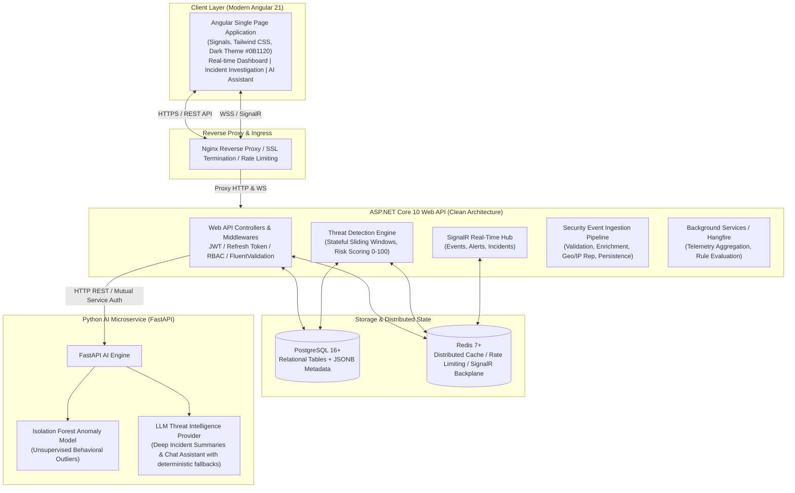

# SecureWatch – System Architecture Specification

## 1. Executive Summary & Purpose

**SecureWatch** is an enterprise-grade Security Information and Event Management (SIEM) and threat detection platform. It ingests, normalizes, analyzes, and correlates security telemetry across hybrid environments in real time. It pairs deterministic, rule-based correlation engines with an AI/ML microservice for Isolation Forest anomaly detection, automated incident summarization, threat explanation, and intelligent security querying.

---

## 2. High-Level Architectural Topology



---

## 3. Clean Architecture (Backend Decomposition)

The backend follows Uncle Bob's Clean Architecture principles, ensuring that enterprise business rules and entities remain independent of UI, frameworks, database systems, and external integrations.

```
src/backend/
├── SecureWatch.Domain/              # Enterprise Entities, Value Objects, Domain Events, Enums
│   ├── Common/                     # BaseEntity, AuditableEntity, IAggregateRoot
│   ├── Entities/                   # User, Role, SecurityEvent, Incident, ThreatDetection, etc.
│   ├── Enums/                      # EventCategory, SeverityLevel, IncidentStatus, etc.
│   └── ValueObjects/               # IpAddress, RiskScore, DetectionWindow
│
├── SecureWatch.Application/         # Use Cases, CQRS/Service Contracts, DTOs, Validators
│   ├── Common/                     # Interfaces (ICurrentUserService, IDateTimeProvider, ICacheService)
│   ├── DTOs/                       # Input & Output models organized by feature
│   ├── Interfaces/                 # Repository contracts, External API abstractions, AIService client
│   ├── Services/                   # IngestionService, ThreatEngine, IncidentManager, AuthService
│   └── Validators/                 # FluentValidation rules
│
├── SecureWatch.Infrastructure/      # Database Context, Migrations, Identity, Redis, External APIs
│   ├── Identity/                   # ApplicationUser, ApplicationRole, TokenProvider, PasswordHasher
│   ├── Persistence/                # SecureWatchDbContext, EntityTypeConfigurations, Seeder
│   ├── Repositories/               # EF Core Repository Implementations
│   ├── Services/                   # RedisCacheService, IpReputationService, EmailService, AuditLogger
│   └── External/                   # PythonAiServiceClient implementation with Resilience & Circuit Breaker
│
└── SecureWatch.Api/                 # Presentation Layer, HTTP Controllers, Hubs, Middlewares
    ├── Controllers/                # Auth, Events, Incidents, Threats, Dashboard, Intelligence, Admin
    ├── Hubs/                       # SecurityHub (SignalR real-time broadcast)
    ├── Middlewares/                # GlobalExceptionMiddleware, RequestLoggingMiddleware, RateLimiter
    └── BackgroundServices/         # EventProcessingWorker, ThreatDetectionBackgroundWorker
```

---

## 4. Subsystem Interactions & Data Flow

### 4.1 Security Event Ingestion & Threat Detection Flow
1. **Ingestion**: External agents or the simulation engine submit events via `POST /api/v1/events`.
2. **Validation & Normalization**: DTOs validated via FluentValidation. IP address parsed, device telemetry extracted.
3. **Enrichment**: IP address checked against local Redis cache; if missed, queried via `IIpReputationProvider` (GeoIP, ASN, Proxy/VPN flags) and cached.
4. **Persistence**: Security event saved to PostgreSQL `security_events` table with structured fields and flexible JSONB metadata.
5. **Real-time Evaluation**: Ingestion triggers `IThreatDetectionEngine`:
   - Checks stateful sliding window counters in Redis (e.g., 5 failed attempts in 60s, brute force patterns, multi-account targeted probes).
   - If a rule triggers, a `ThreatDetection` entity is generated with an explainable 0–100 risk score.
   - If risk score $\ge$ configured threshold (or severity is High/Critical), an `Incident` is automatically generated or linked to an active ongoing incident.
6. **Real-Time Notification**: The event, threat detection, and incident updates are broadcasted to connected analysts via SignalR `SecurityHub`.

### 4.2 AI Assistant & Anomaly Detection Pipeline
1. **Periodic & On-Demand Anomaly Detection**:
   - The Python FastAPI service ingests sanitized feature vectors (e.g. failure frequency, time deviation, IP change rate, targeted accounts count).
   - Scikit-learn's `IsolationForest` identifies multi-dimensional outliers with anomaly scores.
2. **Incident Summarization & Copilot**:
   - When an analyst requests an AI analysis for an incident (`POST /api/v1/ai/analyze-incident`), the backend sanitizes the incident details (redacting any credentials, tokens, or PII).
   - Sends payload to Python AI Service.
   - The AI service processes it via an extensible LLM provider abstraction (supporting OpenAI, Anthropic, Gemini, or local deterministic heuristic fallbacks when offline or no API key is set).
   - Formats explanation: Attack category, Threat Indicators, Impact Analysis, and Recommended Remediations.

---

## 5. Security & Authentication Architecture

1. **Authentication**: ASP.NET Core Identity with custom `ApplicationUser` supporting PBKDF2 / Argon2id password hashing.
2. **Token Lifecycle**:
   - Access Token: Short-lived asymmetric/symmetric JWT (15 minutes).
   - Refresh Token: High-entropy cryptographic random string stored in PostgreSQL and tracked with rotation, expiry, and revocation flags.
   - Device/IP binding: Refresh requests validate origin and revoke descendant tokens upon replay detection.
3. **Authorization & RBAC**:
   - Defined Roles: `SuperAdmin`, `SecurityAdmin`, `SecurityAnalyst`, `Auditor`.
   - Granular Permissions: Policy-based authorization checks at the API controller action level (`[Authorize(Policy = "Permissions.Incidents.Manage")]`).
4. **Data Protection**:
   - Audit logging for every administrative and security-critical action.
   - Sensitive string masking/redaction in API responses and logs.
   - Strict Content Security Policy (CSP), CORS white-listing, X-Content-Type-Options, HSTS headers.

