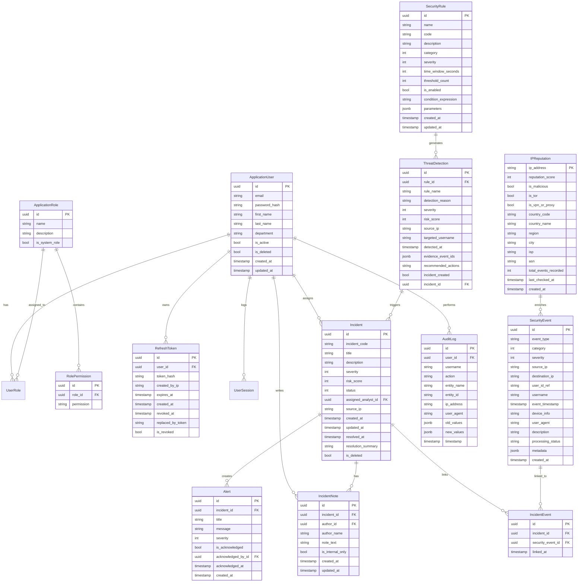

# SecureWatch – Database Design & Schema Specification

## 1. Overview
SecureWatch uses **PostgreSQL 16+** with **Entity Framework Core (Npgsql)**. The schema balances normalized relational tables for transactional integrity (users, roles, permissions, incidents, detections, audit trails) with high-efficiency indexing and JSONB storage for polymorphic event metadata.

All timestamps are stored in UTC (`timestamp with time zone`). Soft deletion (`is_deleted`, `deleted_at`) is applied to critical entities such as users, rules, and incidents to prevent accidental data loss.

---

## 2. Entity Relationship Diagram (ERD)

---

## 3. Table Specifications & Indexing Strategy

### 3.1 `security_events`
- **Primary Key**: `id` (UUID v7 / Sequential GUID)
- **Indexes**:
  - `idx_events_timestamp` on `event_timestamp DESC` (Critical for time-series queries & sliding window detection)
  - `idx_events_source_ip_timestamp` on `(source_ip, event_timestamp DESC)` (Critical for IP correlation & brute force rules)
  - `idx_events_user_timestamp` on `(user_id_ref, event_timestamp DESC)` (Critical for user behavior anomalies)
  - `idx_events_category_severity` on `(category, severity)` (Dashboard filtering)
  - GIN Index `idx_events_metadata_gin` on `metadata` (Fast JSON queries)

### 3.2 `incidents`
- **Primary Key**: `id` (UUID)
- **Unique**: `incident_code` (e.g. `SEC-2026-0001`)
- **Indexes**:
  - `idx_incidents_status_severity` on `(status, severity)`
  - `idx_incidents_assigned_analyst` on `assigned_analyst_id`
  - `idx_incidents_created_at` on `created_at DESC`

### 3.3 `threat_detections`
- **Primary Key**: `id` (UUID)
- **Indexes**:
  - `idx_threats_detected_at` on `detected_at DESC`
  - `idx_threats_source_ip` on `source_ip`
  - `idx_threats_rule_id` on `rule_id`

### 3.4 `ip_reputations`
- **Primary Key**: `ip_address` (VARCHAR(45) supporting IPv4 and IPv6)
- **Indexes**:
  - `idx_ip_rep_score` on `reputation_score`
  - `idx_ip_is_malicious` on `is_malicious`

### 3.5 `audit_logs`
- **Primary Key**: `id` (UUID)
- **Append-Only**: Immutability enforced through API policies. No update/delete endpoints provided.
- **Indexes**:
  - `idx_audit_timestamp` on `timestamp DESC`
  - `idx_audit_user_action` on `(user_id, action)`

